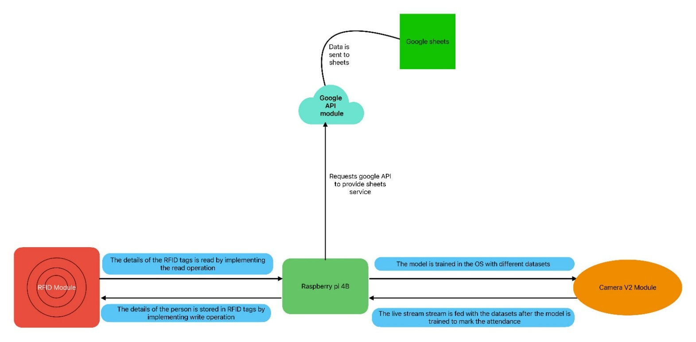
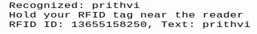

# RFID and Face Recognition Based Smart Attendance System

A smart attendance system that combines facial recognition with RFID verification to mark attendance in a secure and automated way. This project is designed for a Raspberry Pi setup and can log attendance to a local CSV file or a Google Sheet.

## Features

- Face detection and recognition using OpenCV and `face_recognition`
- RFID verification using the MFRC522 reader
- Attendance logging to `attendance.csv`
- Optional Google Sheets integration via `pygsheets`
- Student/employee dataset creation from multiple face images
- Support for Raspberry Pi camera or USB webcam

## Project Overview

This project works in three main stages:

1. Collect face images for each person and store them in a dataset directory.
2. Train the face recognition model to generate encodings.
3. Run the live recognition script, where the system:
   - detects a face,
   - matches it with a known identity,
   - asks the user to scan an RFID tag,
   - validates that the RFID tag belongs to the same recognized person,
   - records attendance.

## System Architecture

Save the project screenshots in an `assets/` folder in the repository so they display correctly in this README.



## Google Sheets API Integration

The system uses a Google API service account to securely send attendance records to the Google Sheet after the RFID badge is validated.


## Attendance Workflow in Action

The system validates the recognized person and logs the attendance entry to Google Sheets after the RFID tag matches the identified face.



## Hardware Requirements

- Raspberry Pi (3/4 recommended)
- MFRC522 RFID reader module
- RFID tags/cards
- USB webcam or Raspberry Pi Camera
- Power supply and jumper wires
- Optional: monitor and keyboard for initial setup

## Software Requirements

This project is designed for Python 3 on Raspberry Pi OS.

Install the required Python packages:

```bash
sudo apt update
sudo apt install python3-opencv python3-pip
pip3 install face_recognition imutils pygsheets
pip3 install RPi.GPIO mfrc522
```

If you are using a Raspberry Pi Camera, also ensure the camera interface is enabled in Raspberry Pi Configuration.

## Repository Structure

```text
RFID-and-Face-Recognition-based-Smart-Attendance-System-using-Machine-Learning/
├── attendance with gsheet.py      # Attendance with Google Sheets logging
├── attendance.csv                 # Local attendance log
├── facial_req.py                  # Face + RFID attendance script
├── haarcascade_frontalface_default.xml
├── headshots_picam.py            # Capture face images for dataset
├── READ_RFID.py                  # Read RFID tag ID/text
├── rfid_read_write.py            # Write and read RFID data
├── service_account.json           # Google Cloud service account credentials
├── train_model.py                # Train and save face encodings
├── README.md                     # Project documentation
├── assets/                       # Add screenshots used in the README
├── dataset/                      # Face dataset folder (created manually)
└── .gitignore
```

## Dataset Preparation

Create a folder structure like this:

```text
dataset/
├── Alice/
│   ├── image_0.jpg
│   ├── image_1.jpg
│   └── ...
├── Bob/
│   ├── image_0.jpg
│   └── ...
└── ...
```

You can collect images using the Raspberry Pi camera script:

```bash
python3 headshots_picam.py
```

When prompted, enter the person's name. Then press the space bar to capture images. Press Esc to exit.

## Training the Model

Once the dataset is ready, run:

```bash
python3 train_model.py
```

This script scans every image in `dataset/`, detects faces, and saves facial encodings into `encodings.pickle`.

## Running Attendance

### 1. Local CSV Logging

Use the main attendance script:

```bash
python3 facial_req.py
```

This script:

- opens the webcam,
- matches detected faces against known encodings,
- asks for RFID tag verification,
- writes attendance entries to `attendance.csv`.

The CSV format is:

```csv
2026-10-12 09:15:22,Alice,123456789
```

### 2. Google Sheets Logging

A second version logs attendance directly to Google Sheets:

```bash
python3 "attendance with gsheet.py"
```

Before running it:

- place your Google service account JSON in `service_account.json`
- create a Google Sheet named `attendance`
- share the sheet with the service account email
- ensure the account has edit access

## RFID Utilities

### Read RFID Tag

```bash
python3 READ_RFID.py
```

This reads and prints the RFID tag ID and stored text.

### Write Data to RFID Tag

```bash
python3 rfid_read_write.py
```

This prompts you for text and writes it to a tag, then reads it back to confirm success.

## How the System Validates Attendance

The recognition flow is:

1. Camera sees a face.
2. Model compares the face to known encodings.
3. The system identifies the likely person.
4. It prompts the user to scan an RFID tag.
5. The tag text is compared with the recognized person's name.
6. If they match, attendance is marked.

This adds a second level of authentication and reduces false attendance entries.

## Important Notes

- The project uses `RPi.GPIO` and `mfrc522`, so it is primarily intended for Raspberry Pi hardware.
- Face recognition accuracy depends on image quality, lighting, and number of training images.
- Add more dataset images per person for better recognition results.
- If the camera or RFID reader is not detected, verify wiring, permissions, and device setup.

## Suggested Workflow

```bash
mkdir -p dataset
python3 headshots_picam.py
python3 train_model.py
python3 facial_req.py
```

## License

This project is provided for educational and experimental use.

## Contributing

If you want to improve this project, consider adding:

- duplicate-attendance prevention,
- admin dashboard,
- database integration,
- real-time dashboard or web interface,
- improved name-to-RFID mapping validation.

## Authors

This project is a Raspberry Pi-based smart attendance solution built around face recognition and RFID authentication.
